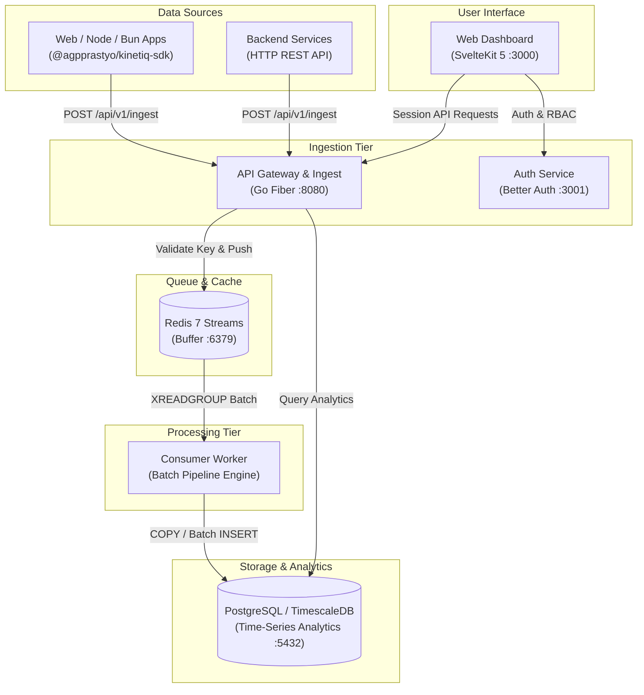

<div align="center">

# ⚡ Kinetiq

**The Lightweight, Ultra-Fast Open-Source Event Telemetry & Product Analytics Engine**

[](LICENSE)
[](https://go.dev)
[](https://bun.sh)
[](docker-compose.yml)
[](CONTRIBUTING.md)

[Quickstart](docs/quickstart.md) • [SDK Guide](docs/sdk.md) • [Backup & Restore](docs/operations/backup-restore.md) • [Upgrade](docs/operations/upgrade.md) • [Contributing](CONTRIBUTING.md)

</div>

---

## 📌 Overview

**Kinetiq** is a self-hosted event ingestion and product telemetry platform engineered for high throughput, sub-millisecond response latency, and complete data sovereignty.

Whether you are tracking website pageviews, mobile user interactions, SaaS product conversions, or distributed service events, Kinetiq gives you full visibility on your own infrastructure without sending customer data to third-party networks.

### ✨ Key Capabilities

- 🚀 **High-Throughput Ingestion**: Powered by Go and Fiber with non-blocking Redis Streams queueing.
- 📊 **Real-Time Analytics & Funnels**: Measure user retention, conversion funnels, top events, active devices, and geolocation distribution.
- 🔒 **Self-Hosted Data Sovereignty**: 100% of your telemetry stays on your servers (PostgreSQL / TimescaleDB).
- 🎨 **Modern Bento Dashboard**: SvelteKit 5 web interface featuring real-time stream inspector, interactive graphs, and dark/light modes.
- 📦 **Multi-Tenant RBAC & API Keys**: Project-scoped API keys (`tlk_live_...`), team invitations, and role-based permissions.
- 🔔 **Multi-Channel Alerting & Webhooks**: Native webhooks with HMAC signatures, Discord/Slack webhooks, and automatic retry circuit breaker.

---

## 🏗️ Architecture



---

## 🚀 60-Second Self-Hosted Quickstart

Deploy the complete Kinetiq stack using Docker Compose:

```bash
# 1. Clone the repository
git clone https://github.com/agpprastyo/kinetiq.git
cd kinetiq

# 2. Configure environment variables
cp .env.example .env

# 3. Launch all services
docker compose up -d

# 4. Verify stack health
kinetiq doctor
# or: make status
```

Once running, open **[http://localhost:3000](http://localhost:3000)** in your browser, register your administrator account, and create your first project.

| Service | URL | Default Purpose |
| --- | --- | --- |
| **Web Dashboard** | [http://localhost:3000](http://localhost:3000) | Visual UI, charts, and project administration |
| **Ingestion API** | [http://localhost:8080](http://localhost:8080) | High-speed event telemetry endpoint |
| **Auth Service** | [http://localhost:3001](http://localhost:3001) | User sessions and authentication sidecar |

👉 See the full **[Self-Hosted Quickstart Guide](docs/quickstart.md)** for production `.env` secrets, first event walkthrough, and troubleshooting.

---

## 📦 Client SDK Quick Usage

Install the official `@agpprastyo/kinetiq-sdk`:

```bash
bun add @agpprastyo/kinetiq-sdk
# or
npm install @agpprastyo/kinetiq-sdk
```

Initialize the client and send your first event:

```typescript
import { KinetiqClient } from "@agpprastyo/kinetiq-sdk";

const kinetiq = new KinetiqClient({
  endpoint: "http://localhost:8080",
  apiKey: "tlk_live_your_project_api_key_here",
});

// Track custom user actions
kinetiq.track("button_click", {
  button_id: "hero-cta",
  screen: "landing_page",
});

// Identify logged-in users
kinetiq.identify("user_10293", {
  email: "alex@company.com",
  role: "engineering_lead",
});
```

👉 See the **[SDK & Ingestion Guide](docs/sdk.md)** for batching, offline storage, autocapture, and `curl` REST API examples.

---

## 📚 Documentation

- **[Self-Hosted Quickstart](docs/quickstart.md)** — Clone, `.env` setup, Docker Compose, `kinetiq doctor`, and first event.
- **[SDK & Ingestion API](docs/sdk.md)** — `@agpprastyo/kinetiq-sdk` usage and `POST /api/v1/ingest` reference.
- **[Backup & Restore](docs/operations/backup-restore.md)** — Automated PostgreSQL backups (`scripts/backup-postgres.sh`) and point-in-time restore (`scripts/restore-postgres.sh`).
- **[Upgrade Guide](docs/operations/upgrade.md)** — Zero-data-loss container upgrades and automatic migrations.
- **[DR & Incident Runbook](docs/runbooks/SELF_HOSTED_DR_AND_INCIDENT_RUNBOOK.md)** — Disaster recovery and incident response procedures.

---

## 🛠️ Monorepo Structure

```text
kinetiq/
├── apps/
│   ├── api/             # Go Fiber telemetry ingestion, worker & CLI
│   ├── auth/            # Better-Auth TypeScript authentication sidecar
│   └── web/             # SvelteKit 5 Bento dashboard
├── packages/
│   └── sdk/             # Official TypeScript/JavaScript client SDK (@agpprastyo/kinetiq-sdk)
├── deploy/              # Production deployment templates
├── docker/              # PostgreSQL initializers & container configurations
├── docs/                # Self-hosted documentation & operational runbooks
├── migrations/          # Versioned SQL database migrations
├── scripts/             # Backup, restore, and verification scripts
└── docker-compose.yml   # Self-hosted Docker Compose stack
```

---

## 🤝 Contributing

We welcome contributions from the community! Check out [CONTRIBUTING.md](CONTRIBUTING.md) to get started with local development, running tests, and submitting pull requests.

## 🛡️ Security

If you discover a security vulnerability, please refer to our [SECURITY.md](SECURITY.md) for instructions on confidential disclosure.

## 📄 License

Kinetiq is open-source software licensed under the [Apache License 2.0](LICENSE).
