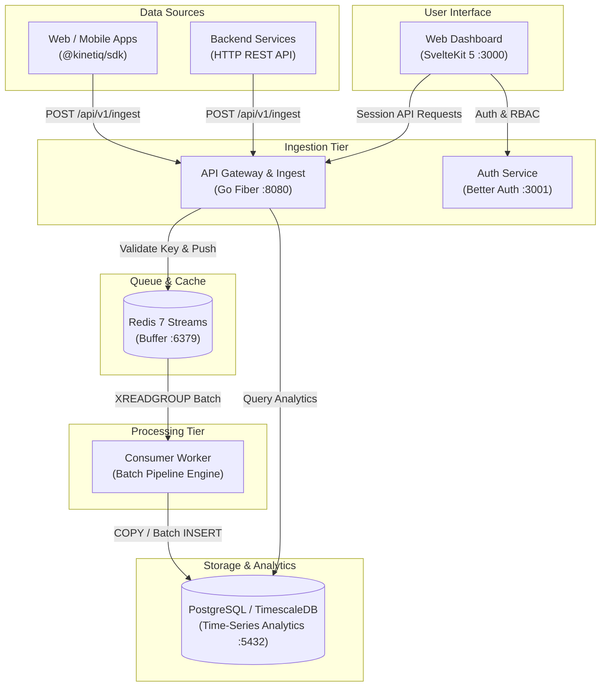

<div align="center">

# ⚡ Kinetiq

**The Lightweight, Ultra-Fast Open-Source Event Telemetry & Product Analytics Engine**

[](LICENSE)
[](https://go.dev)
[](https://bun.sh)
[](docker-compose.yml)
[](CONTRIBUTING.md)

[Quickstart](#-60-second-quickstart) • [Architecture](#-architecture) • [SDK Integration](#-client-sdk-quick-usage) • [API Reference](#-api-endpoints) • [Contributing](#-contributing)

</div>

---

## 📌 Overview

**Kinetiq** is a self-hostable event ingestion and product telemetry platform engineered for high throughput, sub-millisecond response latency, and complete data sovereignty.

Whether you are tracking website pageviews, mobile user interactions, SaaS product conversions, or distributed IoT heartbeats, Kinetiq gives you deep visibility without sending customer data to third-party ad networks.

### ✨ Key Capabilities

- 🚀 **High-Throughput Ingestion**: Powered by Go and Fiber, delivering over 10,000+ RPS on standard compute instances with non-blocking Redis Stream queueing.
- 📊 **Real-Time Analytics & Funnels**: Measure user retention, conversion funnels, top events, active devices, and geolocation distribution instantly.
- 🔒 **Self-Hosted Data Sovereignty**: 100% of your telemetry stays on your servers (PostgreSQL / TimescaleDB), fully GDPR/CCPA compliant by design.
- 🎨 **Modern Bento Dashboard**: Sleek SvelteKit 5 web interface featuring real-time stream inspector, interactive graphs, and dark/light modes.
- 📦 **Multi-Tenant RBAC & API Keys**: Granular project scoped API keys (`tlk_live_...`), team invitations, and role-based permissions.
- 🔔 **Multi-Channel Alerting & Webhooks**: Native webhooks with HMAC signatures, Discord/Slack webhooks, and automatic retry circuit breaker.

---

## 🏗️ Architecture

Kinetiq uses a decoupled, event-driven architecture designed to withstand sudden ingestion spikes without dropping events:



---

## 🚀 60-Second Quickstart

Deploy the complete Kinetiq stack locally or on your server using Docker Compose:

### 1. Clone the repository

```bash
git clone https://github.com/agpprastyo/kinetiq.git
cd kinetiq
```

### 2. Configure environment variables

```bash
cp .env.example .env
```

### 3. Launch with Docker Compose

```bash
docker compose up -d
```

### 4. Access Kinetiq

| Service | URL | Default Purpose |
| --- | --- | --- |
| **Web Dashboard** | [http://localhost:3000](http://localhost:3000) | Visual UI, charts, and project administration |
| **Ingestion API** | [http://localhost:8080](http://localhost:8080) | High-speed event telemetry endpoint |
| **Auth Service** | [http://localhost:3001](http://localhost:3001) | User sessions and authentication sidecar |

Open [http://localhost:3000](http://localhost:3000) in your browser and register your administrator account to create your first project.

---

## 📦 Client SDK Quick Usage

Integrate telemetry into your frontend or Node.js applications with the official `@kinetiq/sdk`:

```bash
bun add @kinetiq/sdk
# or: npm install @kinetiq/sdk
```

### Initialize and Track Events

```typescript
import { Kinetiq } from "@kinetiq/sdk";

// Initialize client
const kinetiq = new Kinetiq({
  endpoint: "http://localhost:8080", // Your Kinetiq API URL
  apiKey: "tlk_live_your_project_api_key_here",
});

// Track page views or custom user actions
kinetiq.track("button_click", {
  button_id: "hero-cta",
  screen: "landing_page",
  plan_interest: "pro",
});

// Identify logged-in users
kinetiq.identify("user_10293", {
  email: "alex@company.com",
  role: "engineering_lead",
});
```

---

## 🔌 API Endpoints

### Ingestion API (Authenticated via Project API Key)

#### `POST /api/v1/ingest`
Header: `Authorization: Bearer <API_KEY>`

```json
[
  {
    "event": "order_completed",
    "user_id": "usr_99812",
    "properties": {
      "currency": "USD",
      "amount": 49.99,
      "items_count": 2
    },
    "timestamp": "2026-11-03T20:15:30Z"
  }
]
```

### Analytics Endpoints (Protected by User Session)

- `GET /api/v1/projects/:id/analytics/summary` — Event counts, unique users, and time-range comparison.
- `GET /api/v1/projects/:id/analytics/timeline` — Time-bucketed volume series.
- `GET /api/v1/projects/:id/analytics/breakdown` — Device, OS, browser, and country distribution.
- `GET /api/v1/projects/:id/analytics/funnels` — Multi-step conversion dropoff funnel analysis.
- `GET /api/v1/projects/:id/live` — Server-Sent Events (SSE) real-time event tail.

---

## 🛠️ Monorepo Structure

```text
kinetiq/
├── apps/
│   ├── api/             # Go Fiber telemetry ingestion & analytics engine
│   ├── auth/            # Better-Auth TypeScript authentication sidecar
│   └── web/             # SvelteKit 5 modern Bento dashboard
├── packages/
│   └── sdk/             # Official TypeScript/JavaScript client SDK
├── deploy/              # Production deployment templates & helm/compose
├── docker/              # PostgreSQL initializers & container configurations
├── migrations/          # Versioned SQL database migrations
└── docker-compose.yml   # 1-click self-hosted compose file
```

---

## 🤝 Contributing

We welcome contributions from the community! Check out [CONTRIBUTING.md](CONTRIBUTING.md) to get started with local development, running tests, and submitting pull requests.

## 🛡️ Security

If you discover a security vulnerability, please refer to our [SECURITY.md](SECURITY.md) for instructions on confidential disclosure.

## 📄 License

Kinetiq is open-source software licensed under the [Apache License 2.0](LICENSE).
